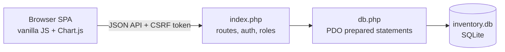

<h1 align="center">📦 RoboInventory</h1>

<p align="center">Inventory, purchases, projects and requests for a robotics lab — one PHP file, one SQLite database, no build step.</p>

<p align="center">
  
  
  
  
</p>

> v2.0 is a full rewrite of the original Flask app. Its databases stay compatible with the Flask
> version, because PHP accepts both bcrypt hash formats.

## What it does

| Module | Highlights |
|---|---|
| **Inventory** | Stock with auto `Available = Total − Used − Taken − Faulty − Sold`, low-stock alerts, duplicate merge, CSV export |
| **Purchases** | Multi-item bills, prices auto-filled from the price list, date filters |
| **Projects & kits** | Ongoing → Upcoming → Completed pipeline; reusable component packages with auto cost |
| **Usage & faults** | Who took what and when, returns, faulty-item log |
| **Sold to schools** | Deducts stock and records the buyer |
| **Requests** | Users request parts; admins approve or reject with a reason; live badge |
| **Dashboard & admin** | KPIs, Chart.js charts, activity feed, users, full audit log |

**Roles:** *Admin* manages everything; *User* views data, submits requests and changes their own password.

## How it works



## Quick start

```bash
# PHP 8.1+ with pdo_sqlite
cp .env.example .env 2>/dev/null || printf 'ADMIN_USER=admin\nADMIN_PASS=change-me\nSECRET_KEY=change-me\nALLOWED_ORIGINS=http://localhost:8080\n' > .env
php -S localhost:8080 index.php      # run from the repo root
```

Open <http://localhost:8080>. `inventory.db` is created on the first request.

<details>
<summary><b>Security features and deployment</b></summary>

bcrypt passwords · 8-hour `HttpOnly` / `SameSite=Lax` sessions · CSRF token on every write ·
10 failed logins per 5 minutes per IP · server-side role checks · `escHtml()` on all rendered content ·
PDO prepared statements.

**Apache:** enable `mod_rewrite`, `AllowOverride All` (uses the included `.htaccess`).
**Nginx:** `try_files $uri $uri/ /index.php?$query_string;` plus PHP-FPM.
</details>

## Status & known issues

| Issue | Risk | Fix |
|---|---|---|
| ⚠️ `.htaccess` serves any existing file, and `inventory.db` + `.env` live in the web root | **On Apache, anyone could download the database and secrets** | Add `<FilesMatch "\.(db\|env)$"> Require all denied </FilesMatch>`, or move both outside the web root |
| Without `.env`, it bootstraps an `admin` / `admin123` account | Default credentials on a fresh deploy | Refuse to start without `ADMIN_PASS`, or force a password change |
| Rate-limit counter uses temp files | Resets on reboot; per-server only | Store attempts in SQLite |
| Old docs said `cd PHP/` | The files are at the repo root | Fixed in this README |
| No screenshots in the repo | Hard to judge the UI at a glance | Add `docs/screenshots/` |

## Roadmap

- [ ] Lock down `.db` / `.env` access; require credentials on first run
- [ ] Screenshots and a demo dataset
- [ ] Barcode/QR scanning for check-in and check-out
- [ ] Docker image for one-command deploys
